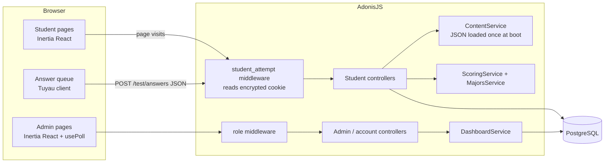

# Learn Explorer v1: Interest Profiler with Tracking and Admin

*   **Author:** Apirak Panatkool
*   **Status:** Proposed
*   **Date:** 2026-11-06
*   **Context:** [concepts_brief.md](../../concepts_brief.md)
*   **Review:** Stage 5 ([zoom_out_report.md](../../zoom_out_report.md)) done. The author then stopped the review and started building. These Stage 5 findings are adopted, and they **override the sections below** where the two disagree:
    *   **M1.** Score on `GET /result` from the `answers` table. `POST /test/answers` only saves the answer and returns the counts, with no lock and no scoring.
    *   **M2.** No `answers_json` column.
    *   **M3.** Re-skin the starter's `.btn`, `.field` and `.panel` classes, and its `Page`, `Section` and `SettingsLayout`. New components are only `LikertScale`, `ProgressBar`, `Attribution` and `Chip`.
    *   **M4.** Run the load test against a local production build and local PostgreSQL.
    *   **M5.** No `home` step and no `home_at`. Test entry time is `created_at`, and `le_entry` carries `code` only.
    *   **N1.** No checksums. Keep only the `content/vN/` folders and `content_version`.
    *   **N2.** The consent version is a code constant, and a test fails on `placeholder`.
    *   **N3.** No `form` column.
    *   **N5.** No `download_count` and no `startedLast60Days`.
    *   **N6.** Keep one `/health` route.
    *   **N7.** Fix the internal inconsistencies, including re-pointing every `dashboard` route reference.
    *   **N8.** Open signup stays, as the author already decided.

--------------------------------------------------------------------------------

## Overview

Learn Explorer is a web app for Thai high-school students. A student answers 30 short "would you like to do this activity?" questions. These are the O*NET Mini Interest Profiler, translated into Thai. The app then shows:

*   the student's RIASEC interest code;
*   occupations that match it;
*   the TCAS university fields that lead to those occupations.

Students arrive from a link sent by another OnDemand system. The link usually carries a `code` that identifies the campaign. They use the app on their phones, mostly in class. They have no account.

OnDemand staff use an admin area. It shows how many students start, reach their result, and download their study plan. It also lets staff look at individual student records.

The working prototype (`../learn_explorer_prototype/src/interest_profiler`) proves the questions, scoring and matching. It is a single page of plain JavaScript and stores nothing. This design rebuilds it in this repo, on AdonisJS 7, Inertia React and PostgreSQL. The rebuild adds storage of each student's progress, accounts for staff, and a dashboard.

## The Problem

OnDemand cannot measure or follow up on the interest profiler today:

*   **No numbers.** The prototype keeps answers in browser memory only. Nobody can tell how many students started, how many finished, or where they dropped off. The success measures (students who open Result, students who Download) cannot be counted.
*   **No follow-up.** Sales cannot contact students who want help planning their studies, because the app collects no contact details or consent.
*   **No resume.** A refresh or a dropped connection on school Wi-Fi loses all answers, and the student starts over.
*   **Hard to maintain.** The prototype is one script with HTML built from strings. Adding the flow steps, admin pages and tests to it would make it harder to change safely.

The proposed solution adds three things on top of the prototype's scoring:

*   a server that saves each answer and each step as it happens;
*   a contact form with a separate consent checkbox;
*   an admin area with roles and a live dashboard.

## Goals

*   **G1. Count the funnel.** For every attempt, the database records the furthest step reached and the time each step was first entered (Home, Test, Result, Career, MyPath). The dashboard shows how many attempts sit at each step, and the counts of Result views and Downloads. These two counts are the success measure.
*   **G2. Never lose an answer.** Each answer is saved to the server when the student taps it. Retries and double taps never create duplicates. A load test with 400 simulated students answering 30 items each, ramping up over 10 seconds, ends with zero lost answers.
*   **G3. Resume in the same browser.** After a refresh, a closed tab, or a dropped connection, the student returns to the next unanswered question. This works for up to 60 days in the same browser.
*   **G4. Same results as the prototype.** For the same answers, the rebuilt scoring returns the same type scores, interest code, validity status, matched occupations, fit levels and TCAS fields as the prototype. A fixed set of at least 20 answer vectors proves it in automated tests.
*   **G5. Contact with consent.** On MyPath, a student can leave a phone number and email and tick a consent box that lets sales contact them. Contact details are stored only when the box is ticked. The consent text is the version Legal approved, and its version is stored with each consent. Download works with or without consent.
*   **G6. Staff accounts with roles.** Anyone can sign up as a member. The first account becomes Owner. The Owner can grant or remove Admin and can hand ownership to another account. There is always exactly one Owner, and the Owner cannot delete their own account. Members see only their own Account page.
*   **G7. Data is kept for a set period.** Admins set the retention period (default 60 days). The admin pages warn when attempts are older than it, and an admin presses Purge to delete them, together with their answers, career views and contact details. The app never deletes on its own. (Changed 2026-11-07 by the project owner, #14: replaces the ace command.)
*   **G8. Maintainable code.**
    *   The code follows the AdonisJS Way in `AGENTS.md`.
    *   Shared UI parts come from a small design system based on the prototype's Sticker Lab theme.
    *   Scoring, flow rules, roles and the dashboard all have Japa tests.

## Non-Goals

*   **Real study-plan content, and any downloadable file.** In v1, Download opens a printable result page. Real study plans and generated files are a later project.
*   **Student accounts and resume across devices.** A new browser or cleared cookies start a new attempt. The author accepted this.
*   **The 60-item form.** Deferred under YAGNI. The scoring port keeps support for it so it can return without rework.
*   **Per-question timing and its median.** Deferred under YAGNI.
*   **The 36-bar "new attempts per 5 minutes" chart.** Deferred under YAGNI. The v1 dashboard shows counts only.
*   **Rate limiting.** Creating attempts with a POST already filters out bots and link previews. Add a limiter only if the counts look abnormal.
*   **Bulk export of student data, and averages across students.** Later analysis can query the database directly. (Export superseded by `docs/adr/0003-student-export.md`.)
*   **Changing the scoring algorithm, the item translation, or the data pipeline.** Content corrections come from the team review of the prototype's data files and are imported as a new content version.
*   **Dark theme.** Sticker Lab is light only by choice.

## Open Questions

*   **Approved consent text (pending from Legal).** Development uses a realistic placeholder, `resources/consent/placeholder-2026-11.th.md`. The author will replace it with Legal's verbatim text before launch. The app refuses to start in production while `CONSENT_VERSION` begins with `placeholder`.

Resolved:

*   **Hosting.** The app and PostgreSQL will run on Railway. Setting up the deploy and CI is out of scope for v1 (author decision). Tests run locally against PostgreSQL.
*   **Content review timing.** Launch with `content/v1` as it is now. The team's corrections arrive later as `content/v2` (author decision).

## Critical User Journeys (CUJs)

### CUJ 1: First-time student completes the profiler

*   **Given**: A student opens `https://explorer.apirak.com/?code=AB5434` on a phone, with no Learn Explorer cookie.
*   **When**:
    1.  The student types a career they are interested in and taps Start.
    2.  They answer all 30 questions.
    3.  They open two occupations on the Career page.
    4.  On MyPath they enter a phone number and email, tick the consent box, and tap Download.
*   **Then**:
    *   One attempt exists with code `AB5434`, furthest step MyPath, and a first-entry time for every step.
    *   It has 30 saved answers, R–C scores, two career views, and one download.
    *   One contact record exists with the consent time and consent text version.
    *   The `code` no longer shows in the address bar after the first page.

### CUJ 2: Student loses connection mid-test

*   **Given**: A student has answered 12 of 30 questions, and the Wi-Fi drops.
*   **When**: The student keeps tapping answers, then refreshes the page after the connection returns.
*   **Then**:
    *   Answers that failed to save are retried in the background.
    *   After the refresh, the app shows "ทำค้างไว้ x/30 ข้อ" with continue or restart.
    *   Continue opens the first unanswered question.
    *   "ดูผล" stays disabled until the server has all 30 answers.

### CUJ 3: Student returns after finishing

*   **Given**: A student finished an attempt yesterday in the same browser.
*   **When**: The student opens the link with the same code again.
*   **Then**: Home offers "view my previous result" or "start again".
    *   View shows the stored result and creates no new attempt.
    *   Start again creates a new attempt with the same code, and leaves the old one unchanged.

### CUJ 4: Shared phone, different student

*   **Given**: A school phone holds an unfinished attempt created with code `AB5434`.
*   **When**: A second student opens a link with code `CD7788` on that phone.
*   **Then**: The app ignores the old attempt and shows a fresh Home. The attempt is created when the student taps Start. The first student's answers are never shown.

### CUJ 5: Staff member signs up and gets access

*   **Given**: An Owner account already exists.
*   **When**: A new staff member signs up.
*   **Then**: Their role is member. They can edit their name and affiliation, change their password, log out, and delete their account. The Admin link is visible but disabled. When the Owner makes them Admin, the link works on their next page load.

### CUJ 6: Owner hands over ownership

*   **Given**: User A is Owner and user B is Admin.
*   **When**: A transfers ownership to B.
*   **Then**: In one transaction, B becomes Owner and A becomes Admin. If any step fails, nothing changes. A can now delete their own account, and B cannot delete theirs.

### CUJ 7: Admin watches a class session

*   **Given**: A class of 40 students is taking the profiler.
*   **When**: An admin opens the Dashboard.
*   **Then**:
    *   The step counts and the Result and Download totals refresh on their own while the tab is visible, and stop refreshing while it is hidden.
    *   The page shows no student names, codes or contact details.

### CUJ 8: Admin reviews one student

*   **Given**: An admin opens the student list.
*   **When**: They open one attempt.
*   **Then**:
    *   They see the step timeline, answers, R–C scores, the interest code, which careers were viewed, and whether the student downloaded.
    *   They see contact details only if the student consented.
    *   The list view masks contact details.
    *   An audit row records which admin opened which attempt.

### CUJ 9: Operator enforces retention

*   **Given**: The database holds attempts from the last 90 days.
*   **When**: An Admin or the Owner sees the warning banner on an admin page, opens Retention, reads how many attempts would be deleted, presses Purge and confirms in the page.
*   **Then**: Every attempt older than the retention period is deleted, along with its answers, career views, downloads and contact details. The log records counts, the period and the admin's user id only. Members get 403.

## Technical Plan (Architecture)

### Shape of the system

The app is one AdonisJS 7 server with Inertia React pages and one PostgreSQL database. It has no Redis, queue, worker, or second service. Every file is created with its `node ace make:*` command and follows `AGENTS.md`.

### Student identity

Students have no account. Two encrypted, httpOnly cookies identify a browser. Both are written with `response.encryptedCookie` and are `Secure` and `SameSite=Lax`:

| Cookie | Holds | Lifetime | Set by |
|---|---|---|---|
| `le_entry` | `{ code, homeAt }`: the campaign code from the link, and when Home was first shown | 1 day | `GET /` |
| `le_attempt` | `{ uuid, code }`: the current attempt's public UUID, and the code it was created with | 60 days | `POST /attempts` |

*   **Arriving with a code.** `GET /?code=…` checks the code: 1–64 characters, letters, digits, `-` and `_` only. A code that fails the check is stored as no code. The server writes `le_entry` and answers with a 302 redirect to `/`. The code is removed from the address bar, history and Referer. The redirect must not forward the query string: `forwardQueryString` in `config/app.ts` is currently `true`.
*   **Finding the attempt.** The `student_attempt` middleware reads `le_attempt` and loads the attempt by UUID. If no row matches (for example, it was purged), it clears the cookie. If `le_entry` holds a code and that code differs from the attempt's code, it ignores the attempt; this is the shared-phone case in CUJ 4. When `le_entry` is missing or has no code (for example, a bookmark opened after `le_entry` expired), the attempt is kept, so resume still works for 60 days. Controllers read the attempt from `ctx`, never from a request parameter, so a student can never reach another student's row.
*   **Lifetime.** The 2-hour session cookie (`config/session.ts:26`) is not used for students. Students have no session state.

### Student flow and steps

| Step | Route | Reached when | Writes |
|---|---|---|---|
| home | `GET /` | Home is shown | `le_entry.homeAt` (copied to the attempt on Start) |
| test | `POST /attempts`, then `GET /test` | Start is tapped | new attempt, `home_at`, `test_at` |
| result | `GET /result` | the result page is shown with all 30 answers saved | `result_at` |
| career | `GET /careers/:code` | the first occupation detail is opened | `career_at`, one `career_views` row per occupation |
| mypath | `GET /mypath` | the MyPath page is shown | `mypath_at` |
| (download) | `POST /mypath/download` | Download is tapped | `downloaded_at` (first time), `download_count + 1`, contact row if consented |

*   **Moving forward.** `Attempt.reachStep(step)` is the only code that moves an attempt forward. It raises `furthest_step` only when the new step is further, and sets that step's `*_at` column only when it is still empty. Going back never lowers anything.
*   **Guards.**
    *   `GET /test`, `GET /result`, `GET /careers/:code` and `GET /mypath` need an attempt. Without one, they redirect to `/`.
    *   `GET /result` and later pages also need a scored attempt. Without one, they redirect to `/test`.
*   **Home choices.**
    *   **Unfinished attempt in the cookie:** Home shows "ทำค้างไว้ x/30 ข้อ" with continue (`GET /test`) or restart (`POST /attempts`).
    *   **Scored attempt in the cookie:** Home shows "view previous result" (`GET /result`, no new row) or "start again" (`POST /attempts`).
    *   Restart and start-again create a new attempt with the same code. The old attempt is never changed again.

### Saving answers (author decision: Tuyau JSON with a retry queue)

*   **Loading the test.** `GET /test` renders one Inertia page. Its props are the 30 Mini-IP items in the prototype's order, with Thai text, plus the answers already saved.
*   **Tapping an answer.**
    *   The page moves to the next question at once.
    *   It sends `POST /test/answers` with `{ itemId, value }` through the Tuyau client. The client sends the XSRF header from the cookie, so CSRF stays on.
    *   The server validates the request with VineJS: the item must be in the active form, and the value must be an integer from 0 to 4.
    *   It saves with `Answer.updateOrCreate({ attemptId, itemId }, { value })`, and returns `{ answered, total }`.
*   **Retries.**
    *   The client keeps unsent answers in a queue in memory, copied to `sessionStorage`.
    *   A network failure (`error.kind === 'network'`) is retried with backoff at 1, 2, 4, 8 and 15 seconds.
    *   A 4xx response is not retried. It is logged to the console and to the server event log.
    *   After 3 failed tries, a Thai notice offers "บันทึกไม่สำเร็จ แตะเพื่อลองใหม่".
*   **Duplicates and races.** A composite unique index on `(attempt_id, item_id)` stops two rows for the same question. If two first saves race, the losing insert raises a unique-violation error. The controller catches it and retries the save once as an update, so double taps and retries are safe.
*   **Scoring.**
    *   When the 30th distinct answer is saved, the controller opens one `db.transaction`. It locks the attempt with `forUpdate()`, and returns early if the attempt is already scored.
    *   It then runs `ScoringService` and stores:
        *   `score_r` … `score_c`;
        *   `interest_code`;
        *   `profile_status`;
        *   `answers_json`, a snapshot of all answers, as the brief asked for one JSON field.
    *   Scores are never accepted from the browser.
*   **Checking before the result.** "ดูผล" is enabled only when the server's latest `answered` equals 30 and the queue is empty.
*   **Changing an answer after scoring.** Later answer changes (Back, or the invalid-profile "กลับไปทบทวน") update the answer row and re-run scoring in the same transaction. The stored scores always match the current answers.

### Content and scoring

*   **Content files.** The generated JSON files are copied unchanged from the prototype into `content/v1/`, with a `manifest.json` that holds the version, source, and a SHA-256 checksum of each file. The files are:
    *   `items_th.json`
    *   `riasec_types_th.json`
    *   `occupations.json`
    *   `occupation_titles_th.json`
    *   `occupation_cip.json`
    *   `tcas_field_to_cip.json`
    *   `tcas_programs.json`
*   **Loading.** `ContentService` loads them once at boot. A measurement on the dev machine gave about 2.5 MB of heap and 15 ms to parse. A lookup takes about 33 ns, so no request touches the database for content.
*   **Versioning.** Each attempt stores `content_version`. A test fails if a file's checksum differs from the manifest without a version change. Corrections from the team review become `content/v2/`. `build.py` stays in the prototype repo as the only data pipeline.
*   **Scoring code.** `ScoringService` and `MajorsService` are line-by-line TypeScript ports of `scoring.js` and `majors.js`. Only the syntax changes; the logic does not. That includes:
    *   question order;
    *   tie order between types;
    *   the all-dislike check before the flat check;
    *   Job Zones 4–5 only;
    *   removing postsecondary teaching jobs;
    *   r ≥ 0, top 5;
    *   fit cut-offs at .729 and .608.

    The 60-item paths are ported as well but not routed.
*   **What the browser receives.** It never gets the 2 MB program list or all 923 occupations. Result and Career pages get only the matched occupations, fields and programs, as transformer output.

### Download (author decision: printable page, no file)

*   `POST /mypath/download` accepts an optional phone, email and `consent` flag, validated by VineJS:
    *   **Phone:** 9–10 Thai digits after removing spaces and dashes. A `+66` prefix becomes `0`.
    *   **Email:** a valid email address, at most 254 characters.
*   If `consent` is true and a phone or email is present, it creates `StudentContact` with `consent_at` and `consent_version`. Without consent, phone and email are discarded and never stored.
*   It then sets `downloaded_at` the first time, adds 1 to `download_count`, and redirects to `GET /mypath/print`. That page shows the result laid out for printing and screenshots, with the O*NET attribution.
*   The dashboard's "Download" therefore means "attempts that tapped Download". A Thai hint on the print page explains how to save it as PDF or a screenshot.

### Admin area

*   **Roles.** `users` gains `role` (`owner`, `admin` or `member`, enforced with `checkIn`) and `affiliation`.
    *   **Signup:** signup runs in a `db.transaction`. If no Owner exists, the new user becomes Owner; otherwise they become member. The race between two simultaneous first signups is accepted by the author.
    *   **Transfer:** ownership transfer runs in a `db.transaction` that locks both rows with `forUpdate()`.
    *   **Deleting:** deleting an account is refused for the Owner. Deleting any account never touches student tables.
*   **Access.** A `role` middleware takes the minimum role as an argument:
    *   `role:admin` protects `/admin/*`.
    *   `role:owner` protects `/admin/users`.
    *   `/account` needs only `auth`.
*   **Dashboard.** `DashboardService.summary()` runs two Lucid queries:
    *   `Attempt.query().groupBy('furthest_step').count('* as total')` for the funnel;
    *   one query for the counts of `result_at IS NOT NULL` and `downloaded_at IS NOT NULL`.

    The page refreshes the `summary` prop every 5 seconds with Inertia's `usePoll`, and pauses while the tab is hidden. The props carry no personal data.
*   **Student list and detail.**
    *   **List:** the list is paginated through a transformer. It masks contact details (for example `08x-xxx-1234`).
    *   **Detail:** shows the step timeline, answers, scores, careers viewed and downloads. Contact details appear only when a contact row exists, which means consent was given.
    *   **Audit:** opening a detail page writes an `admin_audits` row.

### Data model

All timestamps use `table.timestamp(..., { useTz: true })`. Every child table's foreign key to `attempts` uses `.onDelete('CASCADE')`, so the purge deletes children with their attempt.

| Table | Columns | Constraints and indexes |
|---|---|---|
| `users` (alter) | + `role` string, default `member`; + `affiliation` string, nullable | `checkIn(['owner','admin','member'])` |
| `attempts` | `id`; `uuid`; `code` (≤64, nullable); `desired_career` (≤100, nullable); `content_version`; `form` (`mini`); `furthest_step`; `home_at`, `test_at`, `result_at`, `career_at`, `mypath_at`; `score_r` … `score_c` (smallint, nullable); `interest_code` (≤3); `profile_status`; `answers_json` (jsonb); `downloaded_at`; `download_count` (default 0); `created_at`, `updated_at` | `uuid` unique; `furthest_step` `checkIn([...steps])` and index; `created_at` index; `code` index |
| `answers` | `id`; `attempt_id`; `item_id`; `value` (smallint); `created_at`, `updated_at` | unique `(attempt_id, item_id)`; `value` `checkBetween([0,4])` |
| `career_views` | `id`; `attempt_id`; `occupation_code`; `created_at` | unique `(attempt_id, occupation_code)` |
| `student_contacts` | `id`; `attempt_id` (unique); `phone` (nullable); `email` (nullable); `consent_at`; `consent_version`; `created_at` | one per attempt |
| `admin_audits` | `id`; `user_id` (FK users, `SET NULL`); `attempt_id` (FK attempts, `SET NULL`, nullable: a purge keeps the audit trail, #14); `action`; `created_at` | index `attempt_id` |

Column TypeScript types go in `database/schema_rules.ts`. Examples: the `role` union, the `furthest_step` union, and `answers_json` as `Record<string, number>`. Models extend the generated classes and add only relationships, `reachStep`, and `Attempt.score()` (rescores from the answers on each open [M1]).

### Retention

Changed 2026-11-07 by the project owner (#14): the purge is manual from the admin area, and the period is a setting. There is no ace command and no cron.

*   A one-row `settings` table holds `retention_days` (default 60, `checkBetween([1, 3650])`). Admin and Owner change it on `/admin/retention`.
*   `RetentionService` owns the cutoff. `dueCount()` feeds the `retentionDue` shared prop (admin pages only) for the warning banner and the purge screen; `purge()` deletes.
*   The `le_attempt` resume cookie stays at 60 days. A longer period keeps the data, but same-browser resume still ends at 60 days.

*   `POST /admin/retention/purge` deletes attempts whose `created_at` is older than the cutoff, in batches of 500. Cascades remove the child rows.
*   `admin_audits` rows stay: their `attempt_id` becomes null, so who viewed which record survives the purge.
*   It logs `purge_completed` with the deleted count, the period and the admin's user id only [DP-001].
*   The dashboard's "all" range means everything not yet purged.

### Design system

*   **Tokens.** The prototype's Sticker Lab tokens in `style.css` (`:root`, about 21 custom properties) replace the starter's palette in `inertia/css/app.css`. The starter's dark theme and `theme_toggle.tsx` are deleted.
*   **Fonts.** Mali and IBM Plex Sans Thai Looped are self-hosted as subset `woff2` files in `inertia/fonts/`. Nothing loads from Google.
*   **Shared parts.** They live in `inertia/components/ui/`:
    *   `Button`
    *   `Card`
    *   `Chip`
    *   `LikertScale` (real radio inputs, keyboard and screen-reader friendly)
    *   `ProgressBar`
    *   `Field`
    *   `Attribution`
*   **Pages.** Student pages live in `inertia/pages/student/`, admin pages in `inertia/pages/admin/`, and the account page at `inertia/pages/account.tsx`.

### Operations

*   **Logs.** The logger redacts:
    *   `phone`
    *   `email`
    *   `code`
    *   `desiredCareer`
    *   `password`
    *   cookie and authorization headers

    `APP_NAME` is declared in `start/env.ts`. Query bindings are never logged in production. Logs identify attempts by UUID only.
*   **Events.** Structured log events: `attempt_created`, `answer_save_failed`, `attempt_scored`, `download`, `purge_completed`.
*   **Health.** `/health/live` and `/health/ready` run a database check, following `ai-knowledges/adonisjs7/health_check.md`.

## Alternatives Considered

### Alternative A: Create the attempt when Home is opened

*   **Pros**:
    *   Counts every visitor, including people who leave before tapping Start.
    *   This is the behaviour the author first described.
*   **Cons**:
    *   LINE, Facebook and Messenger fetch links to build previews before anyone taps them.
    *   Refreshes, the back button and bots also open Home.
    *   Each of these would add a fake attempt to the counts and to storage.
*   **Reason for Rejection**: Rejected by author after review: fake rows would distort the funnel, and the funnel is the success measure. The attempt is created by `POST /attempts` when Start is tapped. The time Home was first shown is still kept, in the `le_entry` cookie, and copied to the attempt.

### Alternative B: Save answers with Inertia `router.post` on every tap

*   **Pros**:
    *   No queue or other state in the browser.
    *   One request style across the whole app.
    *   Everything can be tested on the server.
*   **Cons**:
    *   The student waits for the server between questions.
    *   Inertia cancels a pending visit when a new one starts, so a fast double tap can drop an answer.
    *   Inertia has no retry.
*   **Reason for Rejection**: Rejected by author: the wait on school Wi-Fi, and the risk of dropped answers, work against G2. The chosen plan uses Tuyau JSON calls with a retry queue.

### Alternative C: Keep answers in the browser and send them in batches

*   **Pros**: About five times fewer requests, and fast screens.
*   **Cons**: Up to 4 answers are lost if the tab closes or the battery dies. A new tab does not see `sessionStorage`. The admin counts lag behind.
*   **Reason for Rejection**: Rejected by author: it breaks G2, which requires saving each answer when it is tapped.

### Alternative D: Generate a PDF on the server with `pdfkit`

*   **Pros**: A real file to keep. Low CPU. Works as a plain GET inside LINE.
*   **Cons**:
    *   Adds a dependency.
    *   The layout has to be drawn in code rather than CSS.
    *   Thai vowel and tone-mark placement depends on the library's font engine and must be tested.
*   **Reason for Rejection**: Rejected by author for v1: real study-plan content comes later, so a printable page is enough for the placeholder.

### Alternative E: Render a PDF with headless Chromium

*   **Pros**: Correct Thai rendering. Reuses the page's CSS. Could grow into the real MyPath document.
*   **Cons**:
    *   Chromium is about 300 MB.
    *   Each render needs about 100 MB or more of RAM and takes 0.5–2 s (estimates).
    *   A whole class tapping Download at once needs a render queue.
    *   Some hosts cannot install Chromium.
*   **Reason for Rejection**: Rejected by author: the cost and deployment risk are too high for a placeholder.

### Alternative F: Store TCAS and occupation data in PostgreSQL

*   **Pros**:
    *   Almost no app memory.
    *   Admins could edit the mapping without a deploy.
    *   SQL reports could join the data directly.
*   **Cons**: Every Result and Career view adds database round trips during class sessions. Those trips compete with answer writes, for data that changes once a year.
*   **Reason for Rejection**: Rejected by author after measurement. Loading the JSON once at boot costs about 2.5 MB of heap and 15 ms, and a lookup takes about 33 ns. Attempts store field keys (for example `10-01`), so reports can still join on them.

### Alternative G: Store only the first answer to each question

*   **Pros**: Matches the author's first request, and would support timing analysis.
*   **Cons**: The prototype lets students go back and change answers, and the invalid-profile screen asks them to. Scores built on first answers would not match what the student chose.
*   **Reason for Rejection**: Rejected after review. Per-question timing was then deferred under YAGNI, so v1 stores only the current answer.

### Alternative H: Answers in a single JSON column only

*   **Pros**: One field, as first requested. Simple reads.
*   **Cons**: Each save is a read-modify-write of the whole field, so two saves at once can lose an answer.
*   **Reason for Rejection**: Rejected after review. The `answers` table, with its unique `(attempt_id, item_id)` index, is the source of truth. `answers_json` stays as a snapshot written when the attempt is scored.

### Alternative I: Raw SQL for constraints and upserts

*   **Pros**:
    *   A partial unique index would enforce "one Owner" in the database.
    *   `ON CONFLICT`, `GREATEST` and `COALESCE` make writes atomic in one statement.
*   **Cons**: These step outside the AdonisJS Way in `AGENTS.md`. They also hide rules in SQL that model tests do not cover.
*   **Reason for Rejection**: Rejected by author. Use the Lucid table builder, model methods and `db.transaction`. `db.raw` and `this.schema.raw` stay only for expressions Lucid cannot write. The author accepts the narrow race on the very first signup.

### Alternative J: Smaller rejected options

*   **Session cookie (2 h) for resume.** Rejected because it is too short. A separate 60-day encrypted cookie is used.
*   **SQLite.** Rejected by author in favour of PostgreSQL.
*   **Server-sent events or Transmit for the dashboard.** Rejected because 5-second polling is enough for a few admins.
*   **Bouncer for roles.** Rejected because one middleware covers three roles.
*   **Rewriting scoring from scratch.** Rejected: port it unchanged and prove the output matches the prototype.
*   **Rate limiting in v1.** Deferred by author, because creating attempts with a POST already filters out bots.

--------------------------------------------------------------------------------

## Non-Functional Requirements

*   **Security and privacy.**
    *   Students are minors, and their data is personal data under PDPA [DP-001].
    *   Students are identified only through encrypted httpOnly cookies, and the attempt is resolved on the server.
    *   Contact details are stored only with consent, together with the approved consent text version.
    *   Admin views of individual students are audited.
    *   Logs are redacted.
    *   Data is kept 60 days.
*   **Performance.** 400 students at once. A load test is the release gate (see Verification Plan). The first Test screen loads in under 200 KB of transferred JS, CSS and fonts, excluding cached files. The database pool is capped at 20 connections.
*   **Rollout and rollback.**
    *   Every migration has a working `down()`.
    *   The deploy runs `node ace migration:run --force` before the app starts.
    *   No existing data needs migrating, because the prototype stored nothing.
    *   Rollback means deploying the previous build and rolling back the last migration batch.

### Additional Resources

*   [concepts_brief.md](../../concepts_brief.md): brainstorm and Goldfish review findings.
*   [AGENTS.md](../../AGENTS.md) and `ai-knowledges/`: the AdonisJS Way and the framework guides.
*   `../learn_explorer_prototype/src/interest_profiler/`: the reference UI, scoring (`scoring.js`, `majors.js`), tests and data.
*   Content review page for the team: https://claude.ai/artifact/WtCPdz17LjzMEuudADANjA

### Future Improvements

*   **60-item form.** Route the already-ported 60-item paths, then add `extend` and a second score set.
*   **Per-question timing.** Measure it, then store the median per form.
*   **36-bar chart.** Add the "new attempts per 5 minutes over 180 minutes" chart.
*   **Real MyPath content.** Build study plans and a generated file.
*   **Rate limiting.** Add `@adonisjs/limiter` if the counts look abnormal.
*   **Railway deploy and CI.** Set these up when the app moves to Railway. (No purge cron: purging stays a manual admin action.)
*   **Database-level one-Owner guard.** Add a partial unique index.

--------------------------------------------------------------------------------

## Detailed Implementation Plan

The work runs in five phases. Each phase ends green: `node ace test`, `npm run typecheck` and `npm run lint` all pass. Create every file with the `node ace make:*` command named in its entry, then edit it. Read the `ai-knowledges/` guide named in `AGENTS.md` before each kind of file.

### Phase P0: Foundation

#### 1. `package.json` (Modify)

*   **Type / Scope**: Dependencies.
*   **Proposed Changes**:
    *   Add `pg`.
    *   Remove `better-sqlite3` and its `allowScripts` entry.
    *   Add `@fontsource/mali` and `@fontsource/ibm-plex-sans-thai-looped`. These are self-hosted fonts that Vite bundles, so nothing loads from Google.
    *   Add a `test:load` script that runs `scripts/load_test.js`.

#### 2. `config/database.ts` (Modify)

*   **Type / Scope**: Configuration.
*   **Proposed Changes**:
    *   Import `env`.
    *   Make `pg` the only connection, reading `DB_HOST`, `DB_PORT`, `DB_USER`, `DB_PASSWORD` and `DB_DATABASE`.
    *   Set `pool: { min: 2, max: 20 }`.
    *   Turn on `debug` only when `NODE_ENV=development`.
    *   Keep schema generation pointed at `database/schema_rules.ts`.
    *   Remove the SQLite block.

#### 3. `start/env.ts` (Modify)

*   **Type / Scope**: Environment validation.
*   **Proposed Changes**: Declare `APP_NAME` (string), `DB_HOST`, `DB_PORT` (number), `DB_USER`, `DB_PASSWORD` (secret), `DB_DATABASE`, and `CONSENT_VERSION` (string, for example `2026-11-v1`).

#### 4. `.env.example`, `.env.test` (Modify)

*   **Type / Scope**: Environment templates.
*   **Proposed Changes**:
    *   Add the variables above with placeholder values. No real secrets.
    *   In `.env.test`, point `DB_DATABASE` at a separate test database (`learn-explorer-test`).

#### 5. `config/app.ts` (Modify)

*   **Type / Scope**: Configuration.
*   **Proposed Changes**: Set `forwardQueryString: false`, so the redirect that removes `?code` does not carry it forward.

#### 6. `config/logger.ts` (Modify)

*   **Type / Scope**: Configuration.
*   **Proposed Changes**: Add a `redact` list:
    *   `phone`, `email`, `code`, `desiredCareer`, `password`;
    *   `req.headers.cookie`, `req.headers.authorization`, `req.headers["x-xsrf-token"]`.

#### 7. `tests/bootstrap.ts` (Modify)

*   **Type / Scope**: Test setup.
*   **Proposed Changes**:
    *   Add `() => testUtils.db().migrate()` to runner setup.
    *   Use `testUtils.db().withGlobalTransaction()` in functional suites, following `ai-knowledges/adonisjs7/reset-state-between-test.md`.

#### 8. (Removed) CI workflow

*   **Type / Scope**: Not in v1. The author deferred CI and deploy setup until the Railway deploy. Tests run locally.

#### 9. `content/v1/*.json`, `content/v1/manifest.json` (Create)

*   **Type / Scope**: Data.
*   **Proposed Changes**:
    *   Copy, byte for byte, the seven generated files listed in the Technical Plan from the prototype's `data/` folder.
    *   `manifest.json` holds:
        *   `{ version: "v1", source: "learn_explorer_prototype@<commit>", onet: "31.0", files: { name: sha256 } }`.
    *   `content/README.md` explains that `build.py` in the prototype is the only pipeline, and that every change makes a new version folder.

#### 10. `app/services/content_service.ts` (Create, `node ace make:service content`)

*   **Type / Scope**: Service, a singleton loaded at boot.
*   **Proposed Changes**:
    *   Read the current version's files once, and verify them against the manifest.
    *   Expose typed getters:
        *   `items(form)`
        *   `types()`
        *   `occupation(code)`
        *   `occupations()`
        *   `thaiTitle(code)`
        *   `fieldsForOccupation(code)`
        *   `programs(fieldKey)`
    *   Expose `version` and `attribution`.

#### 11. `app/services/scoring_service.ts` (Create, `node ace make:service scoring`)

*   **Type / Scope**: Pure functions.
*   **Proposed Changes**:
    *   Port `scoring.js` line by line to TypeScript:
        *   `RIASEC`, `scoreMax`, `questionOrder`, `scoreAnswers`, `interestCode`;
        *   `profileStatus`, `matchOccupations`, `occupationCode`, `sharedHighTypes`;
        *   `fitLevel`, `isPostsecondaryTeaching`.
    *   Only the syntax changes; no logic changes.
    *   Each rule keeps its IP Manual citation comment.

#### 12. `app/services/majors_service.ts` (Create, `node ace make:service majors`)

*   **Type / Scope**: Pure functions.
*   **Proposed Changes**: Port `majors.js` (occupation → ranked TCAS fields) line by line.

#### 13. `tests/unit/scoring.spec.ts`, `tests/unit/majors.spec.ts` (Create, `node ace make:test scoring --suite=unit`)

*   **Type / Scope**: Unit tests.
*   **Proposed Changes**: Port every case from the prototype's `scoring.test.js` and `majors.test.js`, including the real-data checks (Lawyers → นิติศาสตร์, Nurses → พยาบาลศาสตร์).

#### 14. `tests/fixtures/golden_profiles.json`, `tests/unit/golden_parity.spec.ts` (Create)

*   **Type / Scope**: Parity test.
*   **Proposed Changes**:
    *   A one-off script in the prototype repo writes 20 or more answer vectors, together with the prototype's full output for each:
        *   scores
        *   code
        *   status
        *   top 5 occupations with r and fit
        *   TCAS fields
    *   The vectors cover all-dislike, flat, ties, single high type, and random cases, for both the 30-item and 60-item forms.
    *   The spec asserts deep equality with the TypeScript services. This proves G4.

#### 15. `tests/unit/content.spec.ts` (Create)

*   **Type / Scope**: Unit test.
*   **Proposed Changes**: The tests fail if:
    *   a checksum does not match the manifest;
    *   a Job Zone 4–5 occupation has no Thai title (ported from the prototype);
    *   the attribution text is missing.

#### 16. `inertia/css/app.css` (Modify)

*   **Type / Scope**: Design tokens.
*   **Proposed Changes**:
    *   Replace the starter palette and dark-theme blocks with the Sticker Lab tokens from the prototype's `style.css`:
        *   `--paper`, `--ink`, `--lime`, `--purple`, `--violet`, `--line`, `--muted`, `--card`, `--display`, `--body`, and the rest.
    *   Import the `@fontsource` faces.
    *   Keep the starter's utility classes only where the remaining pages use them.

#### 17. `inertia/components/theme_toggle.tsx` (Delete); `inertia/layouts/app.tsx`, `auth.tsx`, `marketing.tsx` (Modify); `app/middleware/inertia_middleware.ts` (Modify)

*   **Type / Scope**: Remove the dark theme.
*   **Proposed Changes**:
    *   Remove the `ThemeToggle` imports and their use in the layouts.
    *   In `inertia_middleware.ts`, remove the `preferences.theme` shared prop and the `app_theme` cookie read.

#### 18. `inertia/components/ui/button.tsx`, `card.tsx`, `chip.tsx`, `likert_scale.tsx`, `progress_bar.tsx`, `field.tsx`, `attribution.tsx` (Create)

*   **Type / Scope**: Design-system components.
*   **Proposed Changes**:
    *   **`Button`:** `primary` and `secondary` variants, built on the prototype's sticker styling.
    *   **`Card`:** a container with the prototype's border, radius and padding.
    *   **`Chip`:** a small label.
    *   **`LikertScale`:** a `radiogroup` of 5 real radio inputs with the prototype's face icons and Thai labels, and arrow-key navigation.
    *   **`ProgressBar`:** shows progress, for example `x/30`.
    *   **`Field`:** a label, an input slot, and a Thai error message.
    *   **`Attribution`:** the full O*NET credit from `ContentService.attribution`, passed as a prop.

### Phase P1: Student flow

#### 19. `database/migrations/<ts>_create_attempts_table.ts` (Create, `node ace make:migration attempts --create=attempts`)

*   **Type / Scope**: Migration.
*   **Proposed Changes**: Columns, checks and indexes as listed for `attempts` in the Data model table. `furthest_step` uses `checkIn(['home','test','result','career','mypath'])`. `down()` drops the table.

#### 20. `database/migrations/<ts>_create_answers_table.ts` (Create, `--create=answers`)

*   **Type / Scope**: Migration.
*   **Proposed Changes**:
    *   `attempt_id` references `attempts.id` with `.onDelete('CASCADE')`.
    *   `item_id` is a string of at most 4 characters.
    *   `value` is a smallint with `checkBetween([0, 4])`.
    *   Add `table.unique(['attempt_id', 'item_id'])` and the timestamps.

#### 21. `database/migrations/<ts>_create_career_views_table.ts` (Create, `--create=career_views`)

*   **Type / Scope**: Migration.
*   **Proposed Changes**: `attempt_id` (FK, cascade), `occupation_code` (string, at most 10 characters), `created_at`, and `table.unique(['attempt_id', 'occupation_code'])`.

#### 22. `database/schema_rules.ts` (Modify)

*   **Type / Scope**: Generated-type rules.
*   **Proposed Changes**: Set TypeScript types for:
    *   `attempts.furthest_step` as a step union;
    *   `attempts.profile_status` as `'ok' | 'all_dislike' | 'flat'`;
    *   `attempts.answers_json` as `Record<string, number> | null`;
    *   `users.role` as `'owner' | 'admin' | 'member'`.

    Run `node ace migration:run` to regenerate `database/schema.ts`. Never edit `schema.ts` by hand.

#### 23. `app/models/attempt.ts`, `answer.ts`, `career_view.ts` (Create, `node ace make:model Attempt` and the others)

*   **Type / Scope**: Models.
*   **Proposed Changes**: Each model extends its generated schema class and adds only the following.
    *   **`Attempt`:**
        *   relationships `hasMany(Answer)`, `hasMany(CareerView)` and `hasOne(StudentContact)`;
        *   a `beforeCreate` hook that sets `uuid` with `crypto.randomUUID()`;
        *   `reachStep(step)` (forward only; sets `*_at` once; saves);
        *   `isScored` (true when `interest_code` is set).
    *   **`Answer`:** `belongsTo(Attempt)`.
    *   **`CareerView`:** `belongsTo(Attempt)`.

#### 24. `app/middleware/student_attempt_middleware.ts` (Create, `node ace make:middleware student_attempt --stack=named`)

*   **Type / Scope**: Middleware.
*   **Proposed Changes**:
    *   Read the `le_attempt` and `le_entry` encrypted cookies.
    *   Load the attempt by `uuid`. If no row matches, clear the cookie.
    *   Treat the attempt as absent only when `le_entry.code` is present and differs from the attempt's `code`.
    *   Set `ctx.attempt` (typed with module augmentation of `HttpContext`). With the `required` option, redirect to `/` when no attempt is found.
    *   Register it in `start/kernel.ts` as `studentAttempt`.

#### 25. `app/validators/student.ts` (Create, `node ace make:validator student`)

*   **Type / Scope**: VineJS validators.
*   **Proposed Changes**:
    *   **`entryQueryValidator`:** `code` optional, `regex(/^[A-Za-z0-9_-]{1,64}$/)`.
    *   **`startValidator`:** `desiredCareer` optional, trimmed, at most 100 characters.
    *   **`answerValidator`:** `itemId` in the active form's ids; `value` an integer from 0 to 4.
    *   **`downloadValidator`:** `phone` optional, normalised to 9–10 Thai digits; `email` optional, at most 254 characters; `consent` boolean.

#### 26. `app/controllers/student_home_controller.ts` (Create, `node ace make:controller student_home`)

*   **Type / Scope**: Controller.
*   **Proposed Changes**:
    *   **`show`, `GET /`:**
        *   If the query has a `code`, validate it, write `le_entry` with `homeAt = now`, and redirect to `/`.
        *   Otherwise render `student/home` with:
            *   `resume`: either null, or `{ answered, total, scored }` from `ctx.attempt`.
            *   `attribution`.
    *   **`start`, `POST /attempts`:**
        *   Validate the request.
        *   Create the `Attempt`, copying `code` and `home_at` from `le_entry`, with `content_version`, `form = 'mini'`, and `furthest_step = 'test'`.
        *   Write `le_attempt`, log `attempt_created`, and redirect to `/test`.

#### 27. `app/controllers/student_test_controller.ts` (Create, `node ace make:controller student_test`)

*   **Type / Scope**: Controller.
*   **Proposed Changes**:
    *   **`show`, `GET /test`:** render `student/test` with:
        *   `items`: the 30 items in order, as id, Thai text and type;
        *   `answers`: the saved values, keyed by item;
        *   `total`: 30.
    *   **`answer`, `POST /test/answers`** (JSON response):
        *   Validate the request.
        *   Run `Answer.updateOrCreate`. On a unique violation, retry once.
        *   Count the attempt's answers.
        *   When the count is 30, call `AttemptScoring.score(attempt)`.
        *   Return `{ answered, total, scored }`.

#### 28. `app/services/attempt_scoring.ts` (Create, `node ace make:service attempt_scoring`)

*   **Type / Scope**: Service.
*   **Proposed Changes**: `score(attempt)` runs inside a `db.transaction`:
    1.  Lock the attempt with `forUpdate()`.
    2.  Load its answers.
    3.  Run `ScoringService.scoreAnswers`, `interestCode` and `profileStatus`.
    4.  Write `score_r` … `score_c`, `interest_code`, `profile_status` and `answers_json`.

    It is idempotent: it always recomputes from the current answers. It logs `attempt_scored`.

#### 29. `app/controllers/student_result_controller.ts` (Create, `node ace make:controller student_result`)

*   **Type / Scope**: Controller.
*   **Proposed Changes**:
    *   **`show`, `GET /result`:** requires a scored attempt; otherwise redirect to `/test`.
    *   Run `reachStep('result')`.
    *   Render `student/result` with:
        *   scores and the interest code with Thai type names;
        *   the profile status;
        *   the top 5 matches, each with its Thai title, fit level and top 3 TCAS fields from `MajorsService`;
        *   the attribution.

#### 30. `app/controllers/student_career_controller.ts` (Create, `node ace make:controller student_career`)

*   **Type / Scope**: Controller.
*   **Proposed Changes**:
    *   **`show`, `GET /careers/:code`:**
        *   Return 404 if the code is not among the attempt's current matches.
        *   Run `CareerView.firstOrCreate`, then `reachStep('career')`.
        *   Render `student/career` with:
            *   the occupation (Thai and English title, RIASEC profile);
            *   its ranked TCAS fields;
            *   up to 20 programs per field;
            *   the attribution.

#### 31. `app/controllers/student_mypath_controller.ts` (Create, `node ace make:controller student_mypath`)

*   **Type / Scope**: Controller.
*   **Proposed Changes**:
    *   **`show`, `GET /mypath`:** run `reachStep('mypath')` and render `student/mypath`. The page shows the consent text from `CONSENT_VERSION`, with the checkbox unticked.
    *   **`download`, `POST /mypath/download`:**
        *   Validate the request.
        *   If `consent` is true and a phone or email is given, run `StudentContact.updateOrCreate({ attemptId }, …)`.
        *   Set `downloaded_at` once, increment `download_count`, log `download`, and redirect to `/mypath/print`.
    *   **`print`, `GET /mypath/print`:** render `student/print`, the result laid out for print and screenshot.

#### 32. `app/transformers/result_transformer.ts`, `occupation_transformer.ts` (Create, `node ace make:transformer result` and the other)

*   **Type / Scope**: Transformers.
*   **Proposed Changes**: Serialize scores, matches, fields and programs for Inertia props, so the frontend receives typed plain JSON.

#### 33. `start/routes.ts` (Modify)

*   **Type / Scope**: Routing.
*   **Proposed Changes**:
    *   Replace `router.on('/')` with the student routes listed in the Technical Plan, and name them `student.*`.
    *   Apply `middleware.studentAttempt()` to all of them except `GET /`, which uses its optional mode.

#### 34. `inertia/pages/student/home.tsx`, `test.tsx`, `result.tsx`, `career.tsx`, `mypath.tsx`, `print.tsx` (Create); `inertia/pages/home.tsx` (Delete)

*   **Type / Scope**: Pages.
*   **Proposed Changes**: Rebuild each prototype screen with the `ui/` components, keeping the prototype's wording and motion.
    *   **`home`:** the desired-career input, the Start button, and the resume or previous-result choice.
    *   **`test`:** one question at a time with `LikertScale`, Back, `ProgressBar`, and the answer queue. "ดูผล" is gated on the server count.
    *   **`result`:** the hexagon, the interest code, matches, and links to `/careers/:code`.
    *   **`career`:** occupation detail and its fields and programs.
    *   **`mypath`:** a phone and email `Field`, the consent checkbox, and the Download button.
    *   **`print`:** print CSS and a Thai save hint.

    The invalid-profile message on `result` links back to `/test`.

#### 35. `inertia/lib/answer_queue.ts` (Create)

*   **Type / Scope**: Client module.
*   **Proposed Changes**:
    *   `enqueue(itemId, value)` keeps only the latest value per item.
    *   `flush()` sends through `client.api` (Tuyau) `.safe()`.
    *   Network errors back off at 1, 2, 4, 8 and 15 s.
    *   4xx errors are dropped and reported.
    *   The queue is copied to `sessionStorage` under the attempt UUID.
    *   It exposes `pending` and `lastServerCount` for the UI.

#### 36. `tests/functional/student_flow.spec.ts` (Create, `node ace make:test student_flow --suite=functional`)

*   **Type / Scope**: Functional tests.
*   **Proposed Changes**: Cover:
    *   CUJ 1 end to end:
        *   `?code` → redirect without the code;
        *   Start creates the attempt;
        *   30 answers produce one scored row;
        *   result, career and mypath set their `*_at` columns once each;
        *   download with consent stores a contact.
    *   CUJ 3: view previous result creates no row, and start again creates one.
    *   CUJ 4: a code mismatch ignores the old attempt.
    *   With no `le_entry`, the old attempt is still resumed.
    *   Duplicate and racing answer posts leave one row per item.
    *   A changed answer after scoring re-scores the attempt.
    *   Download without consent stores no phone or email.
    *   A cookie for a missing attempt is cleared.
    *   An invalid `code` is stored as null.
    *   A 4xx response for an item outside the form.

#### 37. `tests/unit/attempt_steps.spec.ts` (Create)

*   **Type / Scope**: Unit tests.
*   **Proposed Changes**: A table-driven test of `reachStep`. It checks that the step only moves forward, that each `*_at` is set once, and that going back changes nothing.

#### 38. `scripts/load_test.js` (Create)

*   **Type / Scope**: Load test. Plain Node 24 `fetch`, with no new dependency.
*   **Proposed Changes**: Simulate N students (default 400), ramping up over 10 s. Each one:
    *   opens `GET /?code=LOADTEST`;
    *   follows the redirect;
    *   posts Start with its CSRF token;
    *   posts 30 answers at random 1–4 s intervals;
    *   opens `/result`.

    At the end, it reports p50 and p95 latency and the error count, then queries the database to confirm 30 answers per attempt. Run it against a local production build and local PostgreSQL [M4]; it refuses any host but localhost. Plain JS because `pg` ships no types.

### Phase P2: Contact, consent and retention

#### 39. `database/migrations/<ts>_create_student_contacts_table.ts` (Create, `--create=student_contacts`)

*   **Type / Scope**: Migration.
*   **Proposed Changes**:
    *   `attempt_id` is unique and references `attempts` with cascade.
    *   `phone` (at most 10 characters) and `email` (at most 254) are both nullable.
    *   `consent_at` and `consent_version` are not null.
    *   `created_at`.

#### 40. `app/models/student_contact.ts` (Create, `node ace make:model StudentContact`)

*   **Type / Scope**: Model.
*   **Proposed Changes**: Extends its schema class and adds `belongsTo(Attempt)`.

#### 41. `resources/consent/<CONSENT_VERSION>.th.md` (Create)

*   **Type / Scope**: Content.
*   **Proposed Changes**:
    *   Starts as `resources/consent/placeholder-2026-11.th.md`, a realistic placeholder (already in the repo). Before launch, the author adds Legal's verbatim text as a new file and sets `CONSENT_VERSION` to its name.
    *   The MyPath controller reads the file whose name matches `CONSENT_VERSION`.
    *   A test fails if the file is missing.
    *   `start/env.ts` rejects a `CONSENT_VERSION` that begins with `placeholder` when `NODE_ENV=production`, so the placeholder cannot reach students.

#### 42–43. Retention (superseded by #14)

Replaced on 2026-11-07: no ace command. See [Retention](#retention): `settings` migration and model, `RetentionService`, `admin/retention_controller.ts`, `inertia/pages/admin/retention.tsx`, and `tests/functional/admin_retention.spec.ts` (attempts seeded at 1, 59, 61 and 90 days; the warning, what the purge keeps, the period setting, and 403 for members).

### Phase P3: Staff accounts and roles

#### 44. `database/migrations/<ts>_alter_users_add_role.ts` (Create, `node ace make:migration add_role_to_users --alter=users`)

*   **Type / Scope**: Migration.
*   **Proposed Changes**:
    *   Add `role`, a string defaulting to `member`, with `checkIn(['owner','admin','member'])`.
    *   Add `affiliation`, a string of at most 120 characters, nullable.
    *   `down()` drops both columns.

#### 45. `app/models/user.ts` (Modify)

*   **Type / Scope**: Model.
*   **Proposed Changes**: Add the getters `isOwner` and `isAdmin` (true for admin or owner).

#### 46. `app/services/account_service.ts` (Create, `node ace make:service account`)

*   **Type / Scope**: Service.
*   **Proposed Changes**:
    *   **`register(data)`:** inside a `db.transaction`, the new user is Owner if no Owner exists, and member otherwise.
    *   **`setRole(actor, target, role)`:** owner only, and only between `admin` and `member`.
    *   **`transferOwnership(owner, target)`:** a transaction that locks both rows with `forUpdate()`, demotes the old Owner to admin, and promotes the target.
    *   **`deleteAccount(user)`:** refuses for the Owner.

#### 47. `app/controllers/new_account_controller.ts` (Modify)

*   **Type / Scope**: Controller.
*   **Proposed Changes**: Call `AccountService.register` instead of `User.create`. Redirect to `/account`.

#### 48. `app/middleware/role_middleware.ts` (Create, `node ace make:middleware role --stack=named`)

*   **Type / Scope**: Middleware.
*   **Proposed Changes**: Takes `{ min: 'admin' | 'owner' }`. Returns 403 (an Inertia error page) when the logged-in user's role is lower. Register it as `role` in `start/kernel.ts`.

#### 49. `app/validators/account.ts` (Create, `node ace make:validator account`)

*   **Type / Scope**: Validators.
*   **Proposed Changes**:
    *   **`profileValidator`:** `fullName`, `affiliation`.
    *   **`passwordValidator`:** current password, new password, confirmation.
    *   **`roleValidator`:** `role` in `['admin','member']`.

#### 50. `app/controllers/account_controller.ts` (Create, `node ace make:controller account`)

*   **Type / Scope**: Controller.
*   **Proposed Changes**:
    *   `show` and `updateProfile`.
    *   `updatePassword`, which verifies the current password with `User.verifyCredentials`.
    *   `destroy`, which refuses for the Owner with a flash error.
    *   Routes live under `/account` with `auth`.

#### 51. `app/controllers/admin/users_controller.ts` (Create, `node ace make:controller admin/users`)

*   **Type / Scope**: Controller.
*   **Proposed Changes**:
    *   `index` lists users with their roles.
    *   `updateRole` changes a role.
    *   `transfer` transfers ownership.
    *   Routes live under `/admin/users` with `role:{ min: 'owner' }`.

#### 52. `app/transformers/user_transformer.ts` (Modify)

*   **Type / Scope**: Transformer.
*   **Proposed Changes**: Add `role` and `affiliation` to the picked fields, so the Account page can show the role and enable the Admin link.

#### 53. `inertia/pages/account.tsx`, `inertia/pages/admin/users.tsx` (Create); `inertia/pages/dashboard.tsx` (Delete)

*   **Type / Scope**: Pages.
*   **Proposed Changes**:
    *   **Account page:** the profile form, the password form, logout, delete (hidden for the Owner), a role chip, and an Admin link that is disabled unless `user.role` is admin or owner.
    *   **Users page:** a table with role controls and a transfer action. The transfer action is confirmed inside the page, not with a browser `confirm()`.

#### 54. `tests/functional/accounts.spec.ts` (Create, `--suite=functional`)

*   **Type / Scope**: Functional tests.
*   **Proposed Changes**: Cover:
    *   the first signup becomes Owner, and the second becomes member;
    *   a member gets 403 on `/admin`;
    *   the Owner can make a member admin;
    *   after a transfer there is exactly one Owner, and it is the target;
    *   the Owner cannot delete themself;
    *   an Admin cannot reach `/admin/users`;
    *   deleting a user leaves student rows untouched.

### Phase P4: Dashboard and student records

#### 55. `database/migrations/<ts>_create_admin_audits_table.ts` (Create, `--create=admin_audits`); `app/models/admin_audit.ts` (Create)

*   **Type / Scope**: Migration and model.
*   **Proposed Changes**:
    *   Columns as in the Data model table: `user_id` uses `.onDelete('SET NULL')`, and `attempt_id` uses `.onDelete('CASCADE')`.
    *   The model adds `belongsTo` both.

#### 56. `app/services/dashboard_service.ts` (Create, `node ace make:service dashboard`)

*   **Type / Scope**: Service.
*   **Proposed Changes**: `summary()` returns:
    *   `{ steps: Record<step, number>, resultViews, downloads, startedLast60Days, generatedAt }`.

    It uses the two Lucid queries in the Technical Plan and returns no personal data.

#### 57. `app/controllers/admin/dashboard_controller.ts`, `admin/students_controller.ts` (Create, `node ace make:controller admin/dashboard` and the other)

*   **Type / Scope**: Controllers.
*   **Proposed Changes**:
    *   **Dashboard:** renders `admin/dashboard` with `summary`, which the page refreshes with `usePoll(5000, { only: ['summary'] })`.
    *   **Students `index`:** paginates with a transformer. Filters by `code` and by step. Masks contact details.
    *   **Students `show`:** writes an `AdminAudit` row, then renders the attempt:
        *   the timeline;
        *   answers with item text;
        *   scores;
        *   careers viewed;
        *   downloads;
        *   contact details if present.
    *   All routes sit under `/admin` with `role:{ min: 'admin' }`.

#### 58. `app/transformers/attempt_transformer.ts` (Create, `node ace make:transformer attempt`)

*   **Type / Scope**: Transformer.
*   **Proposed Changes**: Two variants, `forList` and `forDetail`. Phone and email are masked in `forList`, and shown in full in `forDetail`.

#### 59. `inertia/pages/admin/dashboard.tsx`, `admin/students/index.tsx`, `admin/students/show.tsx` (Create)

*   **Type / Scope**: Pages.
*   **Proposed Changes**:
    *   **Dashboard:** step counts as horizontal CSS-width bars, the Result and Download totals, and the label "60 วันล่าสุด".
    *   **Student list:** a table.
    *   **Student detail:** sections for the attempt's data.

#### 60. `tests/functional/admin.spec.ts` (Create, `--suite=functional`)

*   **Type / Scope**: Functional tests.
*   **Proposed Changes**: Cover:
    *   the summary counts match seeded attempts;
    *   the summary carries no codes or contact details;
    *   the list masks contact details;
    *   opening a detail page writes one audit row;
    *   a member gets 403.

#### 61. `start/health.ts`, health routes (Create, following `ai-knowledges/adonisjs7/health_check.md`)

*   **Type / Scope**: Operations.
*   **Proposed Changes**: Register the DB check. Expose `/health/live` and `/health/ready`.

#### 62. `AGENTS.md` (Modify)

*   **Type / Scope**: Agent documentation.
*   **Proposed Changes**: Add one line pointing to `content/README.md` for content versioning, and one pointing to this design doc.

### Verification Plan

*   **Compilation/Build**: `npm run typecheck`, `npm run build`.
*   **Unit Tests**: `node ace test unit`. This covers scoring parity (G4), majors, content checksums, and step rules.
*   **Functional Tests**: `node ace test functional` against PostgreSQL. This covers the student flow CUJs 1–4, accounts CUJs 5–6, admin CUJs 7–8, and retention CUJ 9.
*   **Static Analysis & Linting**: `npm run lint`.
*   **Test Coverage Requirement**: Every CUJ has at least one functional test. Every rule in `ScoringService` is reached by a golden vector.
*   **Load (release gate for G2)**: `npm run test:load` against a local production build and local PostgreSQL [M4], with 400 students ramping up over 10 s. The gate is zero lost answers and zero 5xx responses, with a p95 for `POST /test/answers` agreed before launch.
*   **Manual**:
    *   On a real iPhone and a real Android phone, inside LINE and in the default browser:
        *   complete CUJ 1;
        *   kill the network mid-test (CUJ 2);
        *   reopen the link (CUJ 3);
        *   save the print page.
    *   Check that the dashboard refreshes, and pauses when the tab is hidden.

--------------------------------------------------------------------------------

*Drafted with EGM*
